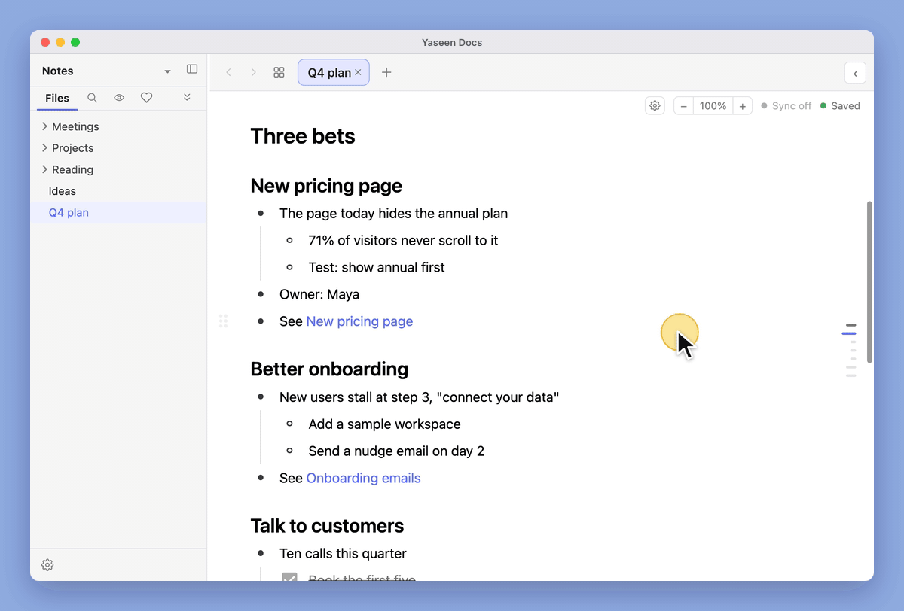
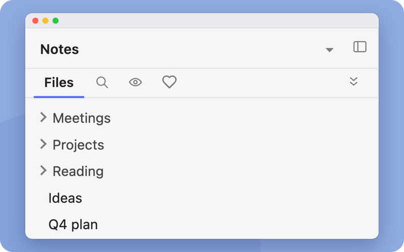
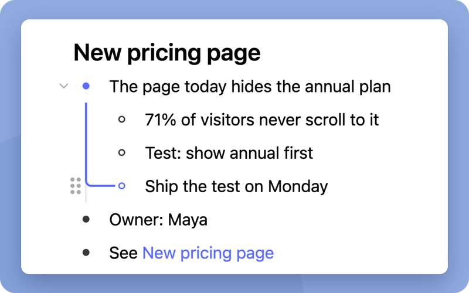
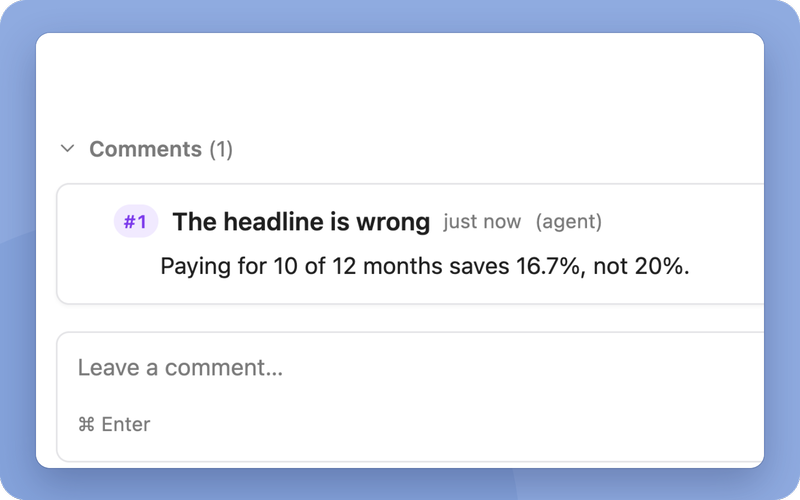
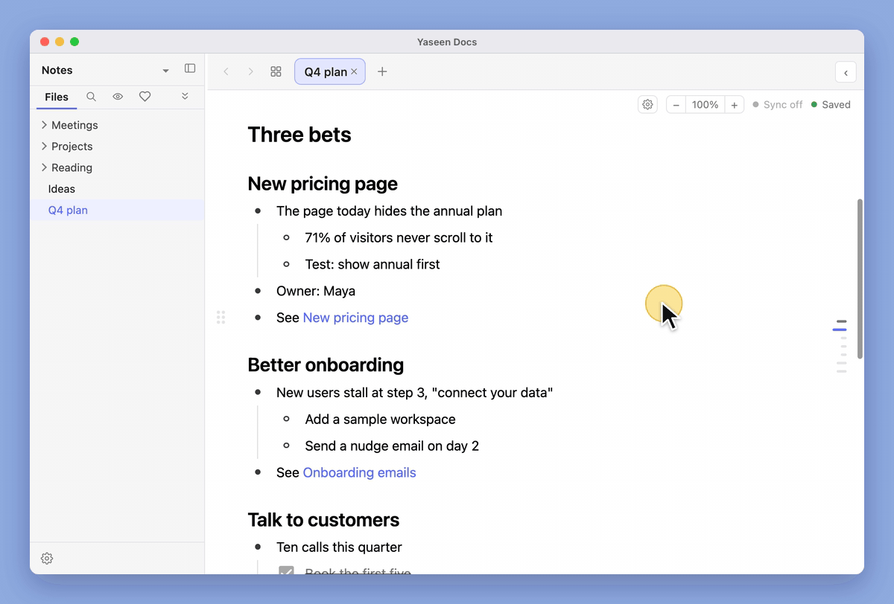
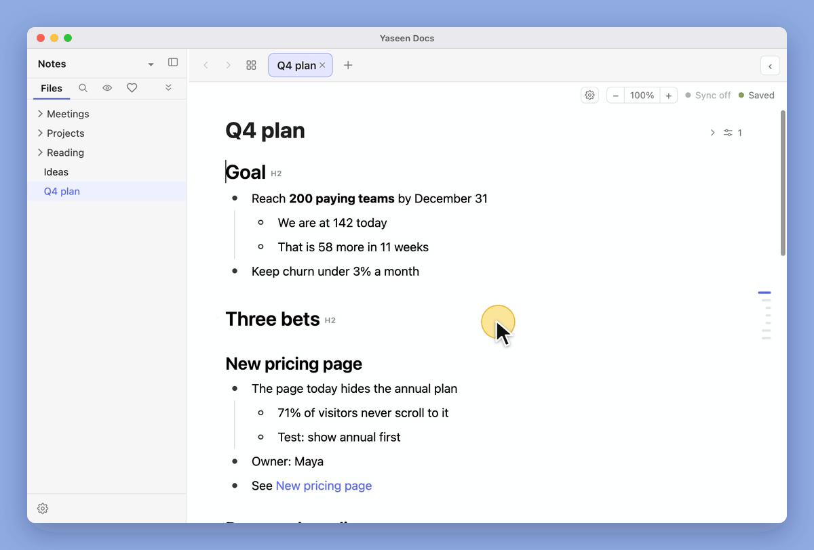
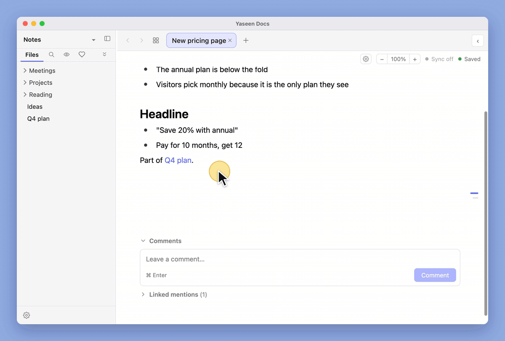
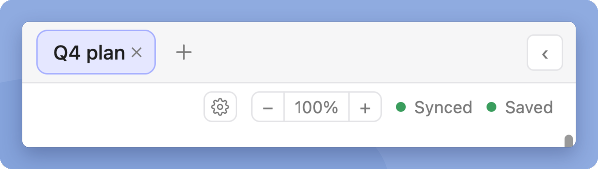
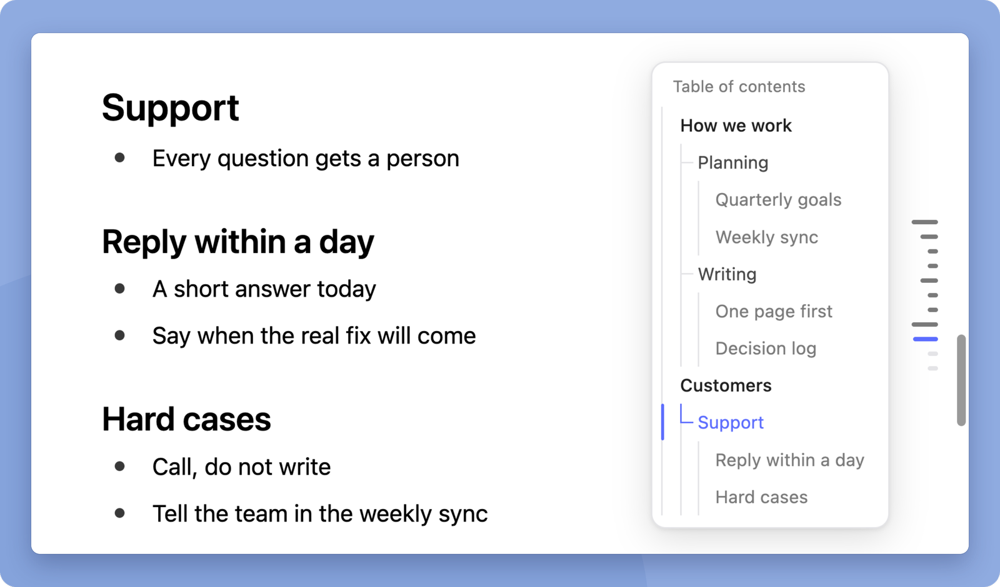

<p align="center">
  
</p>

<p align="center">
  <a href="https://github.com/yaseenarshad/yaseen-docs-app/releases/latest"></a>
  <a href="LICENSE"></a>
  
</p>

<p align="center">
  <a href="https://github.com/yaseenarshad/yaseen-docs-app/releases/latest"><b>Download</b></a> ·
  <a href="#the-answer">How it works</a> ·
  <a href="#the-doubts">Questions</a> ·
  <a href="docs/FEATURES.md">Every feature</a>
</p>

<p align="center">
  <b>Write like Logseq. Organise like Notion. Own your files like Obsidian.<br>And your AI agent reads every note.</b>
</p>

<p align="center">
  
</p>

<p align="center">
  <a href="https://github.com/yaseenarshad/yaseen-docs-app/releases/latest"><b>Download for Mac</b></a> · <a href="https://github.com/yaseenarshad/yaseen-docs-app/releases/latest"><b>Download for Windows</b></a><br>
  <sub>Free · No account · No server · Your notes stay on your computer</sub>
</p>

## The problem

I used Notion for the databases, Logseq for the outliner, Obsidian for the plain files and Google Docs for the smooth writing. Each one is the best at one thing. None of them has all four. Then I started to work with AI agents all day, and agents need notes that are files on your computer. So I built one app where you get the best part of each, on files that your agent can read.

You know these moments:

- You write in Notion, and each paragraph is a block. Your agent goes through an API for each page.
- You move to Obsidian for the files. Then you want to zoom into one bullet, and you need a plugin. You want sync, and it costs from $4 each month.
- You try an outliner. Each line is a bullet, and your notes are on a server or in a database.
- You open Google Docs, because it is smooth. Your bullets do not fold, and there is no file for your agent to open.

<p align="center">
  
</p>

<sub>"Outliners" means Logseq, Roam Research and Workflowy. Logseq is the exception in the last two rows: it is open source, and it needs no account. Its older version keeps markdown files, and its current version stores a database. The price is the price of Obsidian Sync on obsidian.md.</sub>

Four apps, and you paste between them and your agent. You need one.

## The answer

Yaseen Docs gives you the outliner, the databases and the smooth writing in one app, on plain markdown files that your agent opens directly.

<table>
  <tr>
    <td align="center" width="33%"><br><b>1. Open a folder</b><br>Any folder of <code>.md</code> files. No import, no account.</td>
    <td align="center" width="33%"><br><b>2. Write and organise</b><br>Bullets, tables and boards, all on those files.</td>
    <td align="center" width="33%"><br><b>3. Give it to your agent</b><br>It reads the same files and leaves comments.</td>
  </tr>
</table>

## What it does

### Fold it, zoom it, never get lost

Each list is an outline. Fold a bullet, or fold a full heading section. Click the dot of a bullet, and that bullet becomes the page. Drag a bullet by its handle. `Tab` and `Shift-Tab` move it in and out. `⌘Enter` makes it a task, then ticks it. A coloured line shows the path from the top of the list to the bullet that you are on.

All of it is built in. There is no plugin to find and no setting to turn on.

**So what:** a note of 2,000 lines is as easy to work in as a note of 20 lines. And a fold or a zoom is only a view. It never changes your file.

<p align="center">
  
</p>

### Turn any folder into a table or a board

Double-click a folder. It opens as a page, and the notes in it are the rows. There is no setup file and no import. The columns are the properties that your notes already have. Add a Board view, and drag a card to a different column.

It works like a spreadsheet:

- Edit a cell in place, and move between cells with the arrow keys.
- Freeze columns. Drag a column to move it or to make it wider.
- Sort by more than one column. Filter with All, Any or None.
- Get a summary row: Count, Sum, Average, Median, Min, Max and more.
- Group by one property, then by a second one, in a Table and on a Board. Drag a row to a different group, and its value changes.

You get five views: Table, Board, Cards, List and Outline.

**So what:** your projects, your reading list and your meetings each get a database, and there is no database to manage. A column is one line in each note. When you drag a card, the app changes one line in one file, and your agent reads it at once.

<p align="center">
  
</p>

### Your agent comments. It does not edit behind your back.

Each note has a comment thread below it. The app ships a command, `yaseendocs`, that your agent runs. The comment shows in your open note at once. You read it and you answer it in the app, as you do with a person.

The command can edit or delete only the comments that an agent wrote. It refuses to change yours.

**So what:** you see what your agent thinks before it changes one word of your text.

<p align="center">
  
</p>

To set it up on a Mac, put these two lines in the instructions file of your agent (`CLAUDE.md` or `AGENTS.md`). Your agent reads the help and learns the rest.

```
To comment on one of my notes, use this command. Run it with --help first:
"/Applications/Yaseen Docs.app/Contents/Resources/bin/yaseendocs"
```

### Sync with the git that you already have

Turn on GitHub sync for a folder that is a git repo. The app commits and pushes 30 seconds after you stop typing. It pulls when you open the folder and when you come back to the window. It uses the git on your computer, so the app never sees your password.

**So what:** your notes are on each of your computers, with the full history, and you pay for no sync plan.

<p align="center">
  
</p>

### Always know where you are in a long note

A table of contents sits at the right edge of each note. It lists your headings, or your bullets when the note has no headings. Each level has its own tone and its own line, and a marker follows you while you scroll. Click a name to jump there, or press `⌘J` on a Mac. Drag its edge to make it wider.

**So what:** you jump to any part of a long note in one click, and you always see where you are.

<p align="center">
  
</p>

### It is all one file

Here is the note from the pictures above, as it is on disk: its place on the board, and the comment from the agent.

```markdown
---
status: In progress
owner: Maya
due: 2026-10-24
comments:
  - id: e7993087
    n: 1
    at: 2026-10-14T02:11:53Z
    by: agent
    title: The headline is wrong
    body: Paying for 10 of 12 months saves 16.7%, not 20%.
---
## Why

- Annual is below the fold
- Visitors only see monthly

## Headline

- "Save 20% with annual"
- Pay for 10 months, get 12
```

**So what:** open it in any editor. Keep the folder in git. If you stop using Yaseen Docs, your notes are still your notes.

### Also in the box

- **Links that do not break.** Type `[[` to link to a note. Rename or move a note, and its links follow. Rename it outside the app, and the app offers to repair them.
- **Search.** `⌘K` finds a note by title, alias or folder, across each vault in the window.
- **Many vaults, one window.** Put up to 8 folders side by side, and save the set as a workspace.
- **Live reload.** A file that your agent or a different editor changes updates in your open note. If you have edits that are not saved, the app asks first.
- **Permanent IDs, if you want them.** Turn them on for a vault, and each note gets a short ID such as `DOC-12` that you and your agent can say, type and search.
- **Review inbox.** Turn it on, and a note that you did not touch for 30 days comes back for a quick "Still relevant?" check.

The full list, with each shortcut, is in [docs/FEATURES.md](docs/FEATURES.md).

## The proof

Each number is measured, not estimated.

| What | Number |
| -- | -- |
| Automatic tests | 6,719 |
| Releases | 60 in less than 8 weeks |
| From the start of the app to your note on the screen | 385 ms |
| To open a note of 5,000 lines | 1.04 s |
| An edit by your agent shows in your open note | 137 ms |
| From a key press to the screen, at the end of a note of 5,000 lines | 32 ms |

<sub>The speeds are medians on an Apple M3, measured with version 0.9.28.</sub>

What the app does not need:

- No account.
- No payment.
- No server and no telemetry. The app uses the network only when you turn on GitHub sync, or when a note shows a picture from the web.

## The doubts

**Will it change my files?**<br>
Opening a note never writes to it, and your frontmatter stays as it is. The first time that you edit a note, the app saves it in one tidy markdown style: `*` bullets and 2-space indents. IDs stay off until you turn them on.

**Does it work with my Obsidian vault?**<br>
Yes. Open the same folder, and your `[[wikilinks]]` work. Tags show as plain text. The app does not read Obsidian plugins or `.base` files.

**Where do my notes go?**<br>
Nowhere. They stay in your folder. GitHub sync is off until you turn it on, and then it pushes to your own repo with your own git.

**Does it cost money?**<br>
No. It is free, with the [MIT license](LICENSE).

**Why does my computer warn me at the first start?**<br>
The app is not signed with a paid certificate from Apple or Microsoft. You allow it one time, and then it starts like each other app.

**What is not there yet?**<br>
A phone app, a Linux build, a build for Intel Macs, automatic updates, and live editing with other people. The command for agents is for the Mac only.

## The download

[**Download the newest release**](https://github.com/yaseenarshad/yaseen-docs-app/releases/latest). The app needs a Mac with Apple Silicon and macOS 12 or later, or a 64-bit Windows computer.

On a Mac:

1. Open the `.dmg`. Drag **Yaseen Docs** to **Applications**.
2. Open the app. macOS blocks it one time. Go to **System Settings › Privacy & Security** and click **Open Anyway**.
3. Click **Open folder…** and select the folder with your notes.

On Windows:

1. Run the `setup.exe`. SmartScreen shows a warning one time. Click **More info**, then **Run anyway**.
2. Click **Open folder…** and select the folder with your notes.
3. Where this page says `⌘`, press `Ctrl`. A small number of keys, such as `⌘J`, are for the Mac only.

The first three things to try:

1. Click the dot of a bullet to zoom into it. Press `⌘.` to do the same from the keyboard.
2. Double-click a folder. Click **+**, add a **Board**, and drag a card.
3. Give your agent the two lines from above, and ask it to comment on a note.

## For developers

The app is Electron with a React editor that uses Milkdown. The [developer page](docs/DEVELOPMENT.md) tells how to run, build and test it. The rules that the app follows are in [docs/CONTRACTS.md](docs/CONTRACTS.md).

The license is [MIT](LICENSE).
